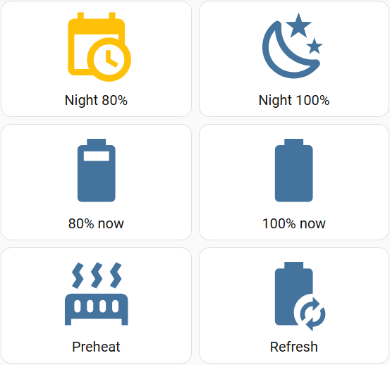
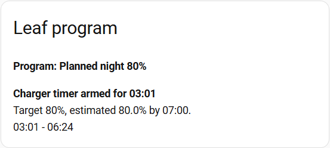

# Nissan Leaf Gen2 + Vevor Smart Charging

Native Home Assistant charging control for a Nissan Leaf Gen2 and a Vevor
EV-B07-EU011B Tuya charger. This is a first source-controlled version of a working
installation, not a Home Assistant add-on or a new custom integration.

The source includes the complete dashboard behavior: button actions, persistent
selected-program indicators, return-to-night-plan command, independent preheat
toggle, read-only program/start information, and the underlying charging logic.
No AppDaemon app or custom dashboard card is required.

## Dashboard

The active charging program is highlighted in amber. The selected icon represents
the requested program, not proof that power is currently flowing. Preheat is
independent and uses the climate entity's reported active state; the tested theme
shows heating in orange. Theme colors can differ.





These are cropped screenshots from the actual installation. The times, estimates,
theme, and state shown are examples, not installation defaults or a live feed.

| Command | Behavior |
| --- | --- |
| Night 80% | Return to Automatic, discard the previous plan, and compute a fresh overnight plan. Can stop an ongoing manual/daytime charge. |
| Night 100% | Request one continuous overnight block targeting 100%. |
| 80% now | Charge immediately toward 80%, ignoring price. |
| 100% now | Charge immediately toward 100%, ignoring price. |
| Preheat | Manually start climate control; press again to stop. Never started by the charging schedule. |
| Refresh | Explicitly request a Nissan vehicle update. This is a cloud request. |

Manual charging requests return to Automatic after confirmed disconnection. They
can also reset when their target is reached; Night 100% expires at 07:00. With
ambiguous local connection telemetry, disconnect confirmation can wait for the
next idle Nissan refresh, approximately 30 minutes plus the service's response time.
Changing a charging program does not implicitly stop preheat.

## Charging Policy

- Automatic targets 80% in the cheapest feasible **continuous** block within
  22:00-07:00 in HA's local timezone. It does not jump between cheap quarters.
- Night 100% uses the same window and continuous-block policy with a 100% target.
- Both overnight programs ignore the early-charge price cap. The planner still
  prefers the cheapest feasible block; price does not prohibit overnight charging.
- Below 20%, an early top-up is allowed only when the current price is strictly
  below the adjustable early-charge cap. The initial setting used here is 50 c/kWh.
- Immediate requests ignore prices but retain the availability, fault, SOC,
  freshness, and configured-current checks.
- Duration is estimated from a configurable percentage-points/hour rate; 8 is the
  initial estimate used here. It is not a measurement of this particular car's
  charge curve or a guarantee of reaching the target by 07:00.
- Once an overnight timer/block has been armed, ordinary replanning preserves it.
  Night 80% deliberately clears that saved plan when explicitly pressed again.

The charger only supports integer-hour delays, 0-12 hours. HA waits until a planned
start is within range, then programs a native timer once. Rounding prefers a later
whole-hour start when the target still fits; otherwise it can start earlier to
prioritize the target. The displayed start uses the acknowledged arming time, so
03:01 rather than an exact market quarter can be expected.

## Architecture and Limits

Charger commands use **local Tuya LAN control**, not Tuya cloud control. Nissan SOC,
plug confirmation, and climate commands still use Nissan's cloud integration.
Prices also require an available price feed. This is not a completely offline system.

The charger has no usable car-SOC limit exposed here. HA implements the 80% cutoff
using Nissan's reported battery level. If HA, the network, or battery updates fail,
an armed charger can start autonomously and may continue toward 100%. The car's
own BMS remains the final authority; do not treat HA as an electrical safety device.

Before issuing charging commands the controller checks charger fault data, control
availability, configured current within 8-16 A, SOC range, and battery-report age.
The normal battery freshness limit is 10 minutes, with a two-minute clock-skew allowance.
An existing complete overnight plan for the same program, target, and request
generation may continue or start using its saved estimate when Nissan battery
data becomes stale. Its saved finish time remains fixed, including during bounded
timer recovery. HA stops the charger at that deadline even without a fresh battery
report; the deadline is checked every minute. Without a valid saved overnight plan,
fresh data is still required. Immediate programs do not use this exception.
Fresh data reaching the target, a fault, disable, or confirmed disconnect still
stops charging. The estimate can undercharge or exceed the requested SOC because
it is not a measurement of the car's current battery level.
Startup handover has a separate five-minute grace because mode/switch and pilot/
power reports do not arrive simultaneously. That grace does not bypass the other
charging guards or extend the saved finish time.

### Request Coordination and Recovery

All charger writes, including reset and idle maintenance, pass through one
transaction script. New program requests invalidate older work; request timestamps
also detect a change away from and back to the same selection. Ordinary feedback
does not queue additional controller runs. Normal requests settle for two seconds,
while disable, fault, target, and invalid active-charge safety data cancel current
verification work promptly.

Arming requires ten seconds of consistent mode/delay/idle feedback after enabling
the timer. The displayed start uses the enable-command time, not the end of that
verification period. Failed acknowledgement clears the timer settings. Immediate
startup verification waits up to five minutes for reported charging activity.

An unexpectedly lost timer or failed start permits at most two recovery attempts
for the same program, with a 60-second retry cooldown. Timer recovery stays within
the original night window and respects the charger's integer-hour constraint;
its replacement start can differ from the original start. Recovery exhaustion
stops the charger and creates a persistent HA notification. An intentional stop,
target completion, fault, disable, or confirmed disconnect does not use this retry
path. Select the required program again to resume a stopped request.

The next-start display distinguishes stopped, recovering, and failed requests.
It shows Charging only with reported power/activity, not merely a passed timestamp.
The request-generation helper must retain its restored value across HA restarts;
do not give it a fixed YAML `initial` value.

The regression suite executes the source templates and transaction sequences in
an offline fixture, including stale requests and delayed feedback. It is not a
simulation of HA's complete asynchronous scheduler or the charger's firmware.
Practical rapid-program-change and delayed-start testing of this coordination
update remains pending; software validation alone does not establish hardware
repeatability.

The controller does not change amperage. Configure the charger independently for
the installation's wiring, circuit protection, and vehicle. The supplied profile
is deliberately limited to the tested 16 A setup; do not raise limits just because
a product listing mentions 32 A.

### Connection Telemetry

In delayed mode this firmware may report `standby`, `available`, and switch `off`
while physically connected with an active countdown. These alone are not proof
of disconnection or cancellation. The saved armed plan and fresh Nissan plug
reports provide additional evidence.

Controller-initiated Nissan refreshes are approximately every 30 minutes while
idle and five minutes while charging or handling immediate requests. There is also
a pre-start refresh and event/manual refreshes. A one-minute local scheduler
checks whether a request is due; it does **not** make a cloud call every minute.
A 60-second cooldown deduplicates automatic requests. Explicit Refresh and the
integration's own activity can add requests; these are not guaranteed Nissan quotas.

On independently confirmed unplug, idle maintenance sets a 12-hour charger delay
and refreshes it every six hours, only while still confirmed unplugged. This is a
best-effort deterrent to immediate plug-in charging, not a permanent interlock:
an outage longer than the charger countdown can defeat it.

`Leaf Connection Observation` passively records local status/pilot changes and
Nissan plug changes in the Logbook, including mode, delay, power, and report time.
It makes no charger commands or cloud calls. Normal usage can therefore provide
evidence for later improvements without a special unplug/replug test tonight.

## Files and Source-Control Strategy

| File | Purpose |
| --- | --- |
| [leaf-smart-charging.yaml](leaf-smart-charging.yaml) | Authoritative source: templates, helpers, scripts, automations, program indicators, dashboard, and prerequisite metadata |
| [tuya_local/vevor_ev_b07_eu011b.yaml](tuya_local/vevor_ev_b07_eu011b.yaml) | Reusable charger-model profile, not an individual device's credentials |
| [export.py](export.py) | Offline conversion to native HA installation files; no HA connection or deployment |
| [test_export.py](test_export.py) | Export/dashboard checks and template/transaction behavior regressions |
| [requirements.txt](requirements.txt) | Export/test dependencies |
| [screenshots](screenshots/) | Cropped documentation images |

**Do not include the source definition directly as an HA package.** Its top-level
metadata sections are not HA domains, and its YAML anchors refer across sections.
The exporter resolves those references and writes independently loadable native
files. This is formatting/packaging of the same logic, not a second controller.

Commit the source and documentation, not generated files, live helper values,
armed plans, downloaded integration code, or full configuration backups. Keep
the running installation and private backups separate. Git operations never
change or cancel an already armed charger timer.

## Prerequisites

The reference installation uses HA Core 2025.10.2, Tuya Local 2025.10.0, and
NissanConnect v0.9.0. Other versions need their own checks. The tested vehicle is
a European 2020 Leaf Gen2 using MyNISSAN; compatibility is not established for
every Gen2 model year, market, account API, or similarly branded charger.

1. Install [Tuya Local](https://github.com/make-all/tuya-local) and
   [HomeAssistant-NissanConnect](https://github.com/dan-r/HomeAssistant-NissanConnect)
   using their upstream instructions.
2. Put the charger on a reachable LAN address, preferably with a DHCP reservation.
   Obtain its individual device ID/local key privately using Tuya Local's guidance.
   Any one-time Tuya cloud discovery is separate from ongoing LAN control. Never
   put that local key or cloud account credentials in this repository.
3. Install the supplied profile under
   `/config/custom_components/tuya_local/devices/vevor_ev_b07_eu011b.yaml` and select
   it for the charger. The model's product ID is `j5bnewrcalhf5rol`; it is not an
   individual device ID. Protocol 3.4 is used in the tested setup. Restart/reload
   as required by Tuya Local, outside an active charging session. Integration
   upgrades may overwrite the manually added profile.
4. Configure the car integration and apply the battery timestamp correction below.
5. Provide Nord Pool quarter-hour price attributes `raw_today` and `raw_tomorrow`,
   each with `start`, `end`, and numeric `value`, in **c/kWh**. The default example
   is Finland/EUR; set HA's timezone appropriately (Europe/Helsinki for this setup).
   An EUR/kWh feed is not interchangeable: normalize it first or adapt the price
   conversion and units consistently. A single current-price sensor is insufficient.

### Battery Timestamp Correction

In NissanConnect v0.9.0, the standard `last_updated` timestamp can advance for
non-battery data. Using it as proof of fresh SOC is unsafe. The tested installation
changes the timestamp sensor factory in
`/config/custom_components/nissan_connect/sensor.py` from:

```python
entities.append(TimestampSensor(coordinator, data[vehicle], 'last_updated', 'last_updated', 'mdi:clock-time-eleven-outline'))
```

to:

```python
entities.append(TimestampSensor(coordinator, data[vehicle], 'battery_status_last_updated', 'last_updated', 'mdi:clock-time-eleven-outline'))
```

Only the first attribute argument changes; keep the translation/unique identity
`last_updated` so the existing entity remains usable. Back up the integration
file privately and reload/restart as appropriate. Confirm that the mapped timestamp
is actually the battery report's time before enabling charging. For a different
integration version, verify its implementation rather than applying this blindly.
Upgrades can overwrite this patch; no upstream fix is claimed here.

### Entity Mapping

Either rename your integration entities to these examples, or replace the example
IDs **consistently throughout the source definition**, including Jinja templates
and dashboard sections, before exporting. Do not rename existing entities without
considering other automations that use them. The `nissan_charge` prefix here names
the LAN charger device, not the Nissan cloud integration.

| Example entity | Required meaning |
| --- | --- |
| `sensor.leaf_battery_level` | Car SOC, percent 0-100 |
| `sensor.leaf_last_updated` | Battery-specific timestamp, as corrected above |
| `binary_sensor.leaf_plugged_in` | Nissan-reported car plug state |
| `button.leaf_update_data` | Nissan force-update action; state is last press time |
| `climate.leaf_climate` | Car climate control; tested `off` / `heat_cool` states |
| `switch.nissan_charge` | Local charger start/stop switch |
| `select.nissan_charge_charging_mode` | Local `immediate` / `delayed_charge` modes |
| `number.nissan_charge_delay` | Native delay, integer hours 0-12 |
| `number.nissan_charge_charge_current` | Configured charger current, amperes |
| `sensor.nissan_charge_power` | Local measured power, **kW**, not W |
| `sensor.nissan_charge_status` | Local enum, including `available` and `charging` |
| `sensor.nissan_charge_connection_state` | Local pilot enum; preserve the profile's exact values/capitalization |
| `binary_sensor.nissan_charge_problem` | Local fault flag, `off` means fault clear |
| `sensor.nissan_charge_energy` | Local kWh, used only in the dashboard |
| `sensor.nordpool_kwh_fi_eur_3_10_0255` | Quarter-hour price feed in c/kWh |

Keep internal `leaf_*` helper, script, automation, and template entity IDs unchanged
for the simplest installation. Pre-existing entities with the same IDs can cause
duplicates/suffixes; choose the appropriate installation route below, not both.

## Generate and Check

Use Python 3.10+ on a development machine, not necessarily the HA host. From the
repository root, a Windows PowerShell example is:

```powershell
python -m venv .venv
.\.venv\Scripts\Activate.ps1
python -m pip install -r automations/leaf-smart-charging/requirements.txt
python -m unittest discover -s automations/leaf-smart-charging -p "test_*.py" -v
python automations/leaf-smart-charging/export.py
```

On Linux/macOS, activate with `source .venv/bin/activate` instead. When activation
is unavailable, invoke that virtual environment's Python executable directly.

The ignored `generated/` directory contains:

| Output | Use |
| --- | --- |
| `package.yaml` | Complete native HA package for a new installation |
| `dashboard.yaml` | One native vertical-stack card, including charger status and all commands |
| `scripts.yaml` | Native script-ID mapping, for an existing UI-managed installation |
| `automations.yaml` | Native automation list |
| `helpers.yaml` | Helper domain definitions |
| `program-templates.yaml` | Four binary program indicators and the active-program sensor |
| `next-start-row.yaml` | Optional conditional row for an existing charger entities card |

The exporter does not contact HA, read local keys, or deploy files. Edit the source
and export again rather than maintaining a second implementation in generated files.

## Install: New Instance

1. Make a private HA backup. Disable conflicting charging automations and do not
   perform first installation during an active charging session.
2. Finish the integrations, profile, timestamp patch, and entity mapping first.
3. Place `generated/package.yaml` at
   `/config/packages/leaf-smart-charging.yaml` on HA. Enable packages in the real
   configuration, merging into an existing `homeassistant:` section if present:

   ```yaml
   homeassistant:
     packages: !include_dir_named packages
   ```

4. Use HA's configuration validation and restart/reload as appropriate for newly
   added YAML helpers/templates. Do not replace your whole configuration with the
   repository's unrelated energy/climate example. On resource-limited hosts, use
   HA's in-process configuration validation rather than launching another HA process.
5. Keep `input_boolean.leaf_smart_charging` **off** initially. Set the early price
   limit helper to **50 c/kWh** and the charge-rate helper to **8 %/h**, or suitable
   values for your installation. Source helper ranges are not initial values;
   first-creation numeric defaults should not be assumed correct.
6. Add a Manual card to a dashboard using the contents of `generated/dashboard.yaml`.
   All cards are built in. Do not paste the whole source definition into a card.
7. Check that the generated entities have the documented IDs and valid states.
   Enable smart charging only when you are ready for a real charger command.

The four `binary_sensor.leaf_program_*` template helpers supply persistent selected
states. `sensor.leaf_active_program` supplies the read-only label. Do not bind these
buttons to script execution state: a script finishing does not end a charging program.

## Existing UI-Managed Instance

The reference installation keeps native scripts/automations/helpers and dashboard
configuration in HA's own stores. It does not load a package. There is no need to
migrate it just to use this repository.

For that route, use the exported fragments to update matching native objects:
merge the script mapping into the existing script configuration (or update each
script's body in its YAML editor), merge automations by their existing `id`, and
reuse helpers/template helpers with the same entity IDs. The source's
`program_indicators` and `program_status` sections also contain the name/state
templates needed to create those helpers through the UI. Add or update the
dashboard cards without replacing unrelated dashboard content.

When updating an older version, also create `input_text.leaf_control_generation`
(name Leaf Control Generation, maximum length 40). Set its value to `base` once
when adopting existing plans that have no generation metadata. Do not reset it on
subsequent updates or restarts. Add the new transaction/request scripts together
with the matching controller and automation changes, not independently.

Do not simultaneously load `package.yaml` and create the same objects through the
UI. Do not blindly append duplicate scripts, automation IDs, helpers, or template
sensors. Validate, reload the relevant native configuration, and inspect states.

## Commissioning and Troubleshooting

With integrations and helpers present, inspect a controller decision without
changing helpers or the charger using Developer Tools > Actions:

```yaml
action: script.leaf_smart_charge_controller
data:
  dry_run: true
  force_replan: true
```

A dry run validates a decision, not electrical operation. Verify a real short
delayed start when convenient, then normal overnight behavior and unplug reset.
Do not fabricate an armed plan or copy a live `input_text.leaf_night_plan` value
from another installation. Its timestamps and internal flags are runtime state;
`q` is an internal temporary-test marker, not a normal mode to enable.

- **Available/standby/switch off during countdown:** can be normal for this firmware.
  Confirm delayed mode, the expected delay, an armed saved plan, and zero power.
- **Arming vs armed:** wait for the acknowledgement. A screenshot taken mid-action
  is not proof the native timer was accepted.
- **Missing next-day prices:** planning waits for a complete forecast rather than
  assuming that missing quarters are cheap. Check the feed's attributes and units.
- **SOC not changing or timestamp stale:** check the Nissan update action and
  battery-specific timestamp patch; do not simply remove the freshness guard.
- **Wrong selected icon:** check internal template entity IDs and master enable.
  No program is selected while smart charging is disabled. Preheat remains separate.
- **Delayed plug/unplug discovery:** inspect the passive Logbook observations.
  No reliable immediate local plug signal is promised in every firmware mode.
- **After integration upgrades:** recheck the custom charger profile, enum values,
  timestamp patch, and entity IDs before relying on overnight operation.

## Validation Status

As of 2026-11-09: a real one-hour delayed start succeeded, the user reported a
working 80% cutoff earlier that day, and the normal overnight timer was armed.
Startup handover/safety, refresh cadence, disconnect reset, high-price overnight
planning, program selection, and fresh connection evidence were checked with HA
runtime template fixtures. Native configuration validation passed; dashboard
colors and desktop/mobile layout were checked.

The repository tests verify packaging and preservation of the source definitions,
not an offline emulation of HA or a charger. A new complete package installation,
the next full overnight run, and physical reconnect behavior still require normal
use/commissioning. Compatibility with other firmware, regions, vehicle models,
future integrations, DST transitions, and network failures is not guaranteed.

## Updates and Rollback

Review source changes, run the tests/export, back up live configuration privately,
and deploy through the same route used for installation. Review the dashboard and
patch prerequisites together with the scripts. A profile or Nissan integration
update may need separate maintenance.

Keep generated files and private entity mappings out of public commits. Never
commit local keys, individual device IDs, passwords, tokens, `.storage`, databases,
vehicle/account exports, VINs, location information, or HA backups. Inspect images
before publishing them. If a secret ever enters Git, rotate it; ignore rules do
not remove it from history.

Rolling back Git alone does not roll back live HA configuration or cancel the
charger's native timer. Restore the known-good live configuration deliberately
and verify the charger's state before leaving it unattended.